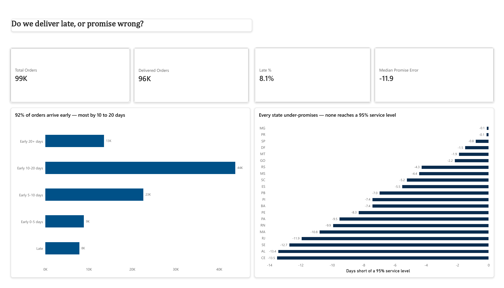
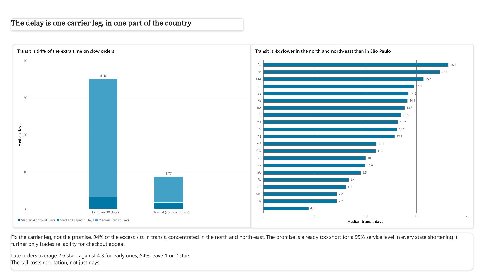

# Do we deliver late, or promise wrong?

A delivery-promise analysis of **96,476 completed e-commerce orders**.

**Tools:** SQL (SQLite) · Python (pandas) · Power BI

---

## The dashboard

Two pages, built in Power BI on the model below. Every chart title states the finding
rather than naming the fields, so the report can be read without a walkthrough.

**Page 1 — is the promise wrong?**



**Page 2 — where does the delay actually happen?**



The report file is in [`dashboard/`](dashboard/). Open `olist-delivery-promise.pbix`
in Power BI Desktop to inspect the measures, the calculated column that defines the
tail band, and the model itself.

---

## The question

Most delivery analyses ask *"why are orders late?"* and answer with distance and
geography. That question carries a hidden assumption: that the promised delivery
date was reasonable to begin with.

This analysis separates two failures that usually get averaged into one number:

| Failure | What it looks like | Who owns the fix |
|---|---|---|
| **Execution** | A realistic promise was missed | Logistics |
| **Forecasting** | The promise was never realistic | Commercial |

They have opposite remedies, and a single on-time percentage hides both.

## What I found

**The promise is not too long. It is too short — and the problem is one carrier
leg, in one part of the country.**

That is the opposite of what the headline numbers suggest, and working out why
is the substance of this analysis.

---

### 1. On the surface, the promise looks wildly over-padded

| Promise error | Orders | Share |
|---|---|---|
| early by 20+ days | 13,484 | 14.0% |
| **early by 10–20 days** | **43,724** | **45.3%** |
| early by 5–10 days | 22,562 | 23.4% |
| early by 0–5 days | 8,879 | 9.2% |
| late | 7,827 | 8.1% |

**91.9% of orders arrive early. The median arrives 11.95 days ahead of the
promised date.** Only 9.2% land within five days of the date the customer was
given.

An over-padded promise is not free. A shopper shown "arrives in 25 days" at
checkout may not wait to discover it was really eight. That cost never appears
on a delivery dashboard, because the dashboard only counts failures in one
direction.

### 2. But measured against the real distribution, no state promises enough

A promise set at a state's 95th-percentile delivery time would be kept 95% of
the time. Comparing that to what each state actually promises:

| State | Orders | Promises | Median actual | 95th pct | Gap | Late |
|---|---|---|---|---|---|---|
| PR | 4,923 | 24.6 | 10.4 | 24.7 | −0.1 | 5.0% |
| MG | 11,355 | 24.5 | 10.3 | 24.7 | −0.2 | 5.6% |
| SP | 40,495 | 19.1 | 7.2 | 20.0 | −0.9 | 5.9% |
| RJ | 12,353 | 26.4 | 12.0 | 38.3 | **−11.9** | 13.5% |
| CE | 1,279 | 31.4 | 18.2 | 44.8 | **−13.4** | 15.3% |
| AL | 397 | 32.6 | 22.3 | 46.0 | **−13.4** | 23.9% |

**Not one of the 21 states promises long enough to hit 95%.**

Both facts are true because delivery times are heavily right-skewed. Take São
Paulo: half of orders arrive within 7.2 days, but one in twenty takes 20. A
19-day promise sits far above the median — so most customers see padding — while
sitting right at the 95th percentile, which is why 5.9% still miss.

**The padding was never generosity. It was insurance against a long tail, and in
some regions there is not enough of it.**

Where volume is highest, calibration is near-perfect: PR, MG and SP are within a
day of a 95% service level and account for 57,000 of 96,000 orders. The promise
breaks down precisely where delivery is least predictable.

### 3. Arriving *very* early buys nothing

| Promise error | Orders | Avg review | 1–2 star | 5 star |
|---|---|---|---|---|
| early by 20+ days | 13,413 | 4.29 | 10.2% | 63.7% |
| **early by 10–20 days** | 43,497 | **4.33** | 8.5% | 64.1% |
| early by 5–10 days | 22,442 | 4.28 | 9.1% | 60.8% |
| early by 0–5 days | 8,816 | 4.15 | 11.0% | 56.0% |
| **late** | 7,662 | **2.57** | **54.0%** | 22.2% |

Across all four early bands the spread is **0.18 review points**. The drop from
early to late is **1.76** — roughly ten times larger. Over half of late
customers leave a 1 or 2 star review.

Scores peak at 10–20 days early and do not improve beyond that. **Avoiding
lateness matters enormously; arriving earlier than about ten days ahead is worth
nothing measurable.**

### 4. The tail is one stage of the journey

Splitting the order lifecycle for orders taking over 30 days (4.7% of all
delivered orders):

| Stage | Normal order | Tail order | Extra | Share of excess |
|---|---|---|---|---|
| purchase → payment approved | 0.01 d | 0.02 d | +0.01 | 0.0% |
| approved → carrier collects | 1.77 d | 3.27 d | +1.50 | 5.7% |
| **carrier → customer** | **6.98 d** | **31.88 d** | **+24.90** | **94.3%** |

Median seller dispatch time is **1.8–2.1 days in every state**, from the best
performer to the worst. Transit ranges from **4.4 days to São Paulo to 18.1 to
Alagoas**, and at the 95th percentile from 14.2 to 42.6.

This rules out payment processing and seller performance as causes. The problem
is the carrier leg, and it is regional.

### 5. Demand surges break the promise

November 2017: orders rose 63% over October (4,631 → 7,544) and the late rate
nearly tripled (5.3% → 14.3%). Black Friday.

Sustained volume is not the issue — mid-2018 ran higher volumes with a 7-day
median delivery. Capacity caught up. It is the spike that breaks.

### 6. The company was already fixing this

The average promise fell from **39.6 days (Jan 2017) to 15.2 days (Aug 2018)**,
while the late rate rose from 3.1% to 10.4%.

That is the trade-off made visible in their own history: a shorter promise wins
at checkout and costs reliability. They had already found the limit of what can
be achieved by adjusting the promise alone.

---

## Recommendation

**Do not shorten the promise.** It is already too short for a 95% service level
everywhere, and the three largest states are calibrated correctly.

**The lever is the transit tail, not the promise.** In Alagoas, 27% of orders
take over a month. No single promised date works there: quote 32 days and you
lose customers at checkout *and* still miss a quarter of the time — which is
exactly what is happening.

Three things follow:

1. **Investigate the carrier leg in the north and north-east.** It is 94% of the
   excess time on tail orders, and 4–7 days of it is not explained by distance
   when compared against similar-distance states.
2. **Protect peak periods.** Black Friday tripled the miss rate. Either add
   capacity or lengthen the promise for that window deliberately.
3. **Stop treating the promise as a single national decision.** Reliability
   varies five-fold across states; a uniform policy cannot serve both.

Fixing the tail allows a shorter promise *and* better reliability at once.
Adjusting the promise alone only trades one against the other.

---

## What I expected, and what was actually true

I began expecting the finding to be "the promise is padded by two weeks, tighten
it." The first two cuts of the data supported that.

Two things changed it:

- **Measuring against the distribution rather than the average.** Compared to
  the median, every state looks over-padded. Compared to the 95th percentile,
  every state is under-padded. Same data, opposite conclusion.
- **Testing the variance explanation instead of asserting it.** I claimed
  lateness was driven by spread rather than slowness. The correlations say
  slowness (0.77) and the tail (0.82) both predict it better than spread (0.67),
  and all three are entangled.

Both corrections are recorded here rather than quietly dropped, because an
analysis that never contradicts its author is usually one that stopped looking.

---

## Limitations

- **No checkout data.** Every order here is from a customer who *accepted* the
  long promise. The shoppers who left are invisible, so the cost of over-padding
  cannot be measured — only argued.
- **No carrier identity.** The slow stage is clear; which carrier or route is
  responsible is not.
- **Distance is not isolated.** The geolocation table is not used, so "far" and
  "badly served" cannot be fully separated. Comparing similar-distance states is
  the obvious next step.
- **Small states are imprecise.** AL's 23.9% late rate rests on 397 orders
  (±4.2 points). AL and MA cannot reliably be ranked against each other.
- **Censored periods excluded.** 2016-09 to 2016-12 (4, 324 and 1 orders) and
  2018-09 to 2018-10 (all orders still in transit at the data cut-off). August
  2018 is included but understates lateness: 2.5% of its orders had not yet
  arrived.
- **The 30-day tail threshold is a choice, not a property of the data.** It was fixed
  before the stage breakdown was run, so it was not tuned to produce a result, but it
  remains arbitrary. A different cut would change the size of the tail group and the
  "94% of the excess" figure. The *direction* of the finding does not depend on it:
  median dispatch time varies by only 0.3 days across all 21 states, so no threshold
  makes dispatch the explanation.
- **Reviews are a proxy.** They capture satisfaction among buyers, not revenue,
  and are influenced by product quality as well as delivery.

---

## Data

**Brazilian E-Commerce Public Dataset by Olist** — ~100,000 orders placed
between September 2016 and October 2018, published under CC BY-NC-SA 4.0.

Source: https://www.kaggle.com/datasets/olistbr/brazilian-ecommerce

Eight tables are used: orders, order items, payments, reviews, customers,
sellers, products and the category translation.

The raw CSVs are **not committed** (see `.gitignore`). Download them from the
link above into `data/raw/`.

**Provenance:** the files used were verified against two independent public
copies; the five tables present in both were byte-for-byte identical.

**Data quality:** nine issues were found and resolved, each recorded with its
reasoning in [`docs/issues-log.md`](docs/issues-log.md) — including a grain
mismatch that would have inflated every delivery metric by basket size, and a
`customer_id` field that identifies orders rather than people.

## Reproducing this

```bash
python scripts/02_build_database.py data/raw data/olist.db
python scripts/04_create_view.py    data/olist.db sql/01_order_model.sql
python scripts/05_analysis.py       data/olist.db outputs
```

Every figure in this README is printed by the third command.

## Repository

```
sql/01_order_model.sql        the model: eight tables to one row per order
sql/02_analysis_queries.sql   exploratory queries run against the model view
scripts/01_inspect.py         first look at the raw data
scripts/02_build_database.py  CSVs into SQLite, with date normalisation
scripts/03_run_model.py       runs the model, validates grain, writes CSV
scripts/04_create_view.py     registers the model as a database view
scripts/05_analysis.py        all six analyses
dashboard/                    Power BI report (.pbix), PDF and page exports
docs/issues-log.md            every data problem and what was decided
outputs/                      summary tables (generated)
```

A note on the structure: the modelling is SQL and the statistics are Python.
Joins and grain belong in a database; medians, percentiles and correlations do
not exist in SQLite. Each tool does what it is good at.

---

*Mia Deita — [LinkedIn](https://www.linkedin.com/in/deitamia/)*
